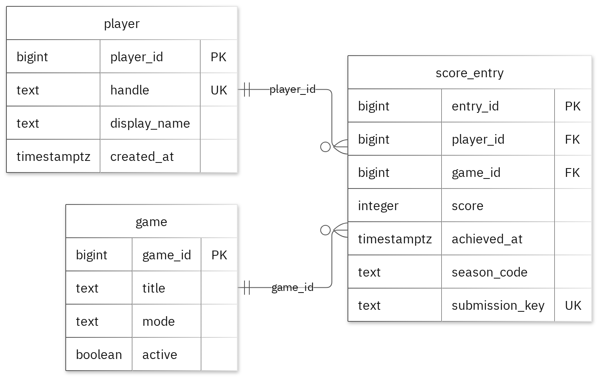
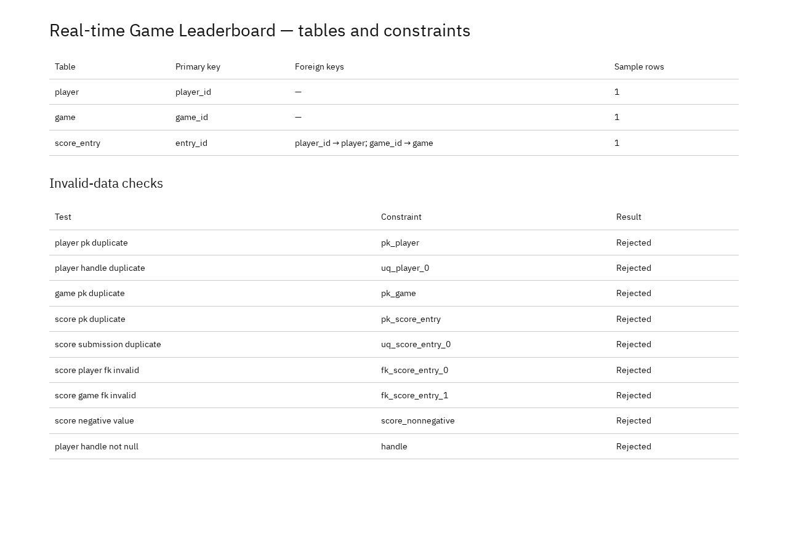

# Portfolio 1 — Database Design and Modelling

## Purpose and case-study context

The case study is a **Real-time Game Leaderboard**. Players submit scores for a game and season, viewers read rankings, and operators review submissions. This portfolio defines the relational core: `player`, `game` and `score_entry`. It covers the entity model, keys, business constraints and normalisation evidence that the later portfolios reuse.

## Design and approach

### Schema overview

| Entity | Purpose | Primary key | Other keys and rules |
| --- | --- | --- | --- |
| `player` | Leaderboard participant | `player_id` | `handle` is unique and required; `display_name`, `created_at` required |
| `game` | Game with a leaderboard | `game_id` | `title`, `mode`, `active` required |
| `score_entry` | One score submission for a player, game and season | `entry_id` | `player_id` → `player`; `game_id` → `game`; `submission_key` unique; `score >= 0` |

Relationships:

- One `player` can have zero or many `score_entry` records; each `score_entry` references exactly one `player`.
- One `game` can have zero or many `score_entry` records; each `score_entry` references exactly one `game`.
- `score_entry` is the associative entity between `player` and `game`.
- `submission_key` is a client-provided idempotency key, so a retried submission cannot be inserted twice.
- `achieved_at` is the time the score was achieved; it is stored as `timestamptz`.

The full field list and assumptions are in the [design document](Oyewale_Taiwo_301926988_P1_Design.md).

### ER diagram



Figure 1. Tables, keys and relationships. PK = primary key; FK = foreign key; UK = unique value. The Mermaid source is in the [ER diagram document](Oyewale_Taiwo_301926988_P1_ERDiagram.md).

### Normalisation result

The [normalisation document](Oyewale_Taiwo_301926988_P1_Normalisation.md) walks the saved sample record through 1NF, 2NF and 3NF:

- **1NF:** the grouped score-entry list becomes one row per submission, with one value per cell.
- **2NF:** the candidate keys are single-column, so there is no partial dependency; the 1NF rows remain unchanged.
- **3NF:** player and game descriptions are stored once in their own tables, while `score_entry` keeps only the foreign keys. Joining the three tables reproduces the original sample row.

Because the sample holds one score entry, this is a worked illustration of the dependencies rather than a proof over a large dataset. The declared functional dependencies are listed in the normalisation document.

## Files

| File | Contents |
| --- | --- |
| [Design](Oyewale_Taiwo_301926988_P1_Design.md) | Users, operations, entities, fields, keys, relationships and business rules |
| [ER diagram](Oyewale_Taiwo_301926988_P1_ERDiagram.md) | Mermaid entity-relationship source and image link |
| [Normalisation](Oyewale_Taiwo_301926988_P1_Normalisation.md) | 1NF, 2NF and 3NF worked example |
| [Schema](Oyewale_Taiwo_301926988_P1_Schema.sql) | `portfolio` schema, three tables, primary/unique/foreign-key/check constraints |
| [Sample data](Oyewale_Taiwo_301926988_P1_SampleData.sql) | One fictional player, game and score entry |
| [Constraint tests](Oyewale_Taiwo_301926988_P1_ConstraintTests.sql) | Nine deliberately invalid inserts |
| [Table and constraint evidence](screenshots/Oyewale_Taiwo_301926988_P1_DatabaseResults.png) | Row counts and the nine expected rejections (Figure 2) |

## Prerequisites

- PostgreSQL 17 server and `psql` 17 on `PATH` (the scripts use standard SQL and should also run on recent PostgreSQL versions).
- A role that can create a database and a schema. The examples use the `postgres` superuser; replace it with your own role if needed.
- Run all commands from this `portfolio-1-database-design` folder.
- The expected starting state is a **new, empty database**. The schema script creates the `portfolio` schema, so do not run it twice against the same database.

## How to run

Create a fresh database and load the schema and sample rows:

```bash
createdb -U postgres leaderboard
psql -U postgres -d leaderboard -v ON_ERROR_STOP=1 -f Oyewale_Taiwo_301926988_P1_Schema.sql
psql -U postgres -d leaderboard -v ON_ERROR_STOP=1 -f Oyewale_Taiwo_301926988_P1_SampleData.sql
```

Expected result: both commands finish with `CREATE SCHEMA`, three `CREATE TABLE`/`ALTER TABLE` messages and `COMMIT`; the sample script reports three `INSERT 0 1` statements and `COMMIT`.

Run the constraint tests. They must run **outside a transaction**, one statement at a time:

```bash
psql -U postgres -d leaderboard -f Oyewale_Taiwo_301926988_P1_ConstraintTests.sql
```

The file intentionally contains nine failing statements. By default `psql` continues after each error; if your `psqlrc` sets `ON_ERROR_STOP` on, run the statements individually or turn it off for this file.

Expected result: **nine `ERROR` lines**, each naming the expected constraint, no inserted rows, and the valid sample data unchanged. The last test reports a not-null violation on `handle`:

| # | Test | Expected constraint | SQLSTATE |
| --- | --- | --- | --- |
| 1 | Duplicate player primary key | `pk_player` | 23505 |
| 2 | Duplicate player handle | `uq_player_0` | 23505 |
| 3 | Duplicate game primary key | `pk_game` | 23505 |
| 4 | Duplicate score-entry primary key | `pk_score_entry` | 23505 |
| 5 | Duplicate submission key | `uq_score_entry_0` | 23505 |
| 6 | Invalid player foreign key | `fk_score_entry_0` | 23503 |
| 7 | Invalid game foreign key | `fk_score_entry_1` | 23503 |
| 8 | Negative score | `score_nonnegative` | 23514 |
| 9 | Null player handle | `handle` | 23502 |

`psql` prints the constraint name in the error detail; SQLSTATE values appear when `VERBOSITY verbose` is enabled.

Verify that only the valid rows remain:

```bash
psql -U postgres -d leaderboard -c "
SELECT 'player' AS table_name, count(*) FROM portfolio.player
UNION ALL SELECT 'game', count(*) FROM portfolio.game
UNION ALL SELECT 'score_entry', count(*) FROM portfolio.score_entry
ORDER BY table_name;"
```

Expected result:

| table_name | count |
| --- | --- |
| game | 1 |
| player | 1 |
| score_entry | 1 |

## Results and evidence

| Table | Rows |
| --- | --- |
| `player` | 1 |
| `game` | 1 |
| `score_entry` | 1 |

All nine invalid inserts were rejected at their expected constraints, and the valid sample rows remained unchanged. Figure 2 records the table/key summary and each rejection.



Figure 2. Table row counts and the nine constraint tests, all rejected. This is the captured evidence for this portfolio.

## Limitations and reflection

The sample is deliberately tiny: one player, one game and one score entry. It demonstrates the schema and constraint behaviour but cannot show realistic data volume, concurrency or query performance. The design also stores one row per submission, so leaderboard ranking queries must aggregate or filter `score_entry`; Portfolio 2 examines that workload. Scores are assumed to be non-negative integers, and `submission_key` is assumed to be supplied reliably by the client. The `created_at` and `achieved_at` values are fictional sample timestamps.

## References

- [PostgreSQL 17 — constraints](https://www.postgresql.org/docs/17/ddl-constraints.html)
- [Mermaid — entity-relationship diagrams](https://mermaid.js.org/syntax/entityRelationshipDiagram.html)
