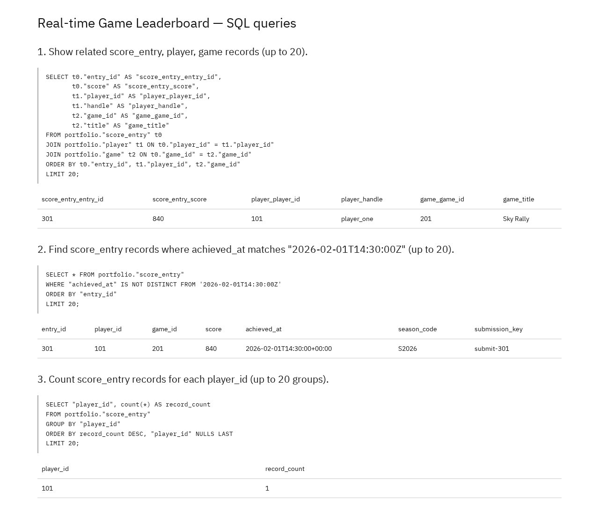
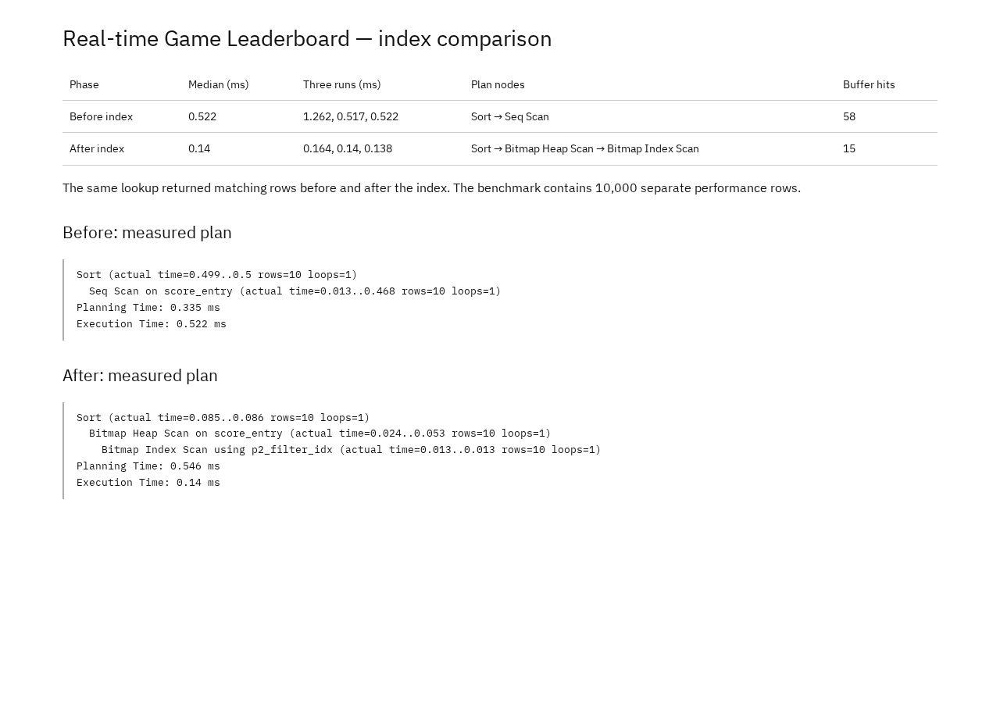

# Portfolio 2 — Query Processing and Optimisation

## Purpose and case-study context

The Real-time Game Leaderboard needs to show a player's score rows joined to player and game details, find scores by achievement time, and count submissions per player. This portfolio runs three representative SQL queries against the Portfolio 1 data, then measures the effect of a B-tree index on a selective `achieved_at` lookup.

## Design and approach

### Queries

The three queries in [Queries.sql](Oyewale_Taiwo_301926988_P2_Queries.sql) cover:

1. a three-table join from `score_entry` to `player` and `game` (ranked display data);
2. an equality filter on `achieved_at` (score lookup by time);
3. a `GROUP BY player_id` count (submission volume per player).

Each query is also run under `EXPLAIN (ANALYZE, BUFFERS, FORMAT JSON)` so the plan can be inspected.

### Benchmark dataset

The one-row sample cannot show an index effect, so [Optimisation.sql](Oyewale_Taiwo_301926988_P2_Optimisation.sql) creates a **separate lab table**, `query_lab.score_entry`, with only two columns:

- `achieved_at`, using the same `timestamptz` type as the case table;
- `lab_row_id`, an integer row identifier.

It inserts **10,000 synthetic rows**, with timestamps spread over 1,000 seconds starting at `2030-01-01T00:00:00Z`. Because the generator uses `g % 1000`, each second contains **10 rows**; the measured lookup at 42 seconds therefore returns 10 rows. This is a deliberately selective lookup (about 0.1% of the table) and is not a complete set of case records. The case data and its constraints are untouched; the lab table exists only for this measurement.

### Index choice and trade-offs

A B-tree index on `query_lab.score_entry.achieved_at` matches the equality predicate and avoids scanning all 10,000 rows. It is appropriate because the case includes time-based score lookups and the predicate is selective.

The trade-offs are:

- extra storage for the index;
- write maintenance on every insert, update or delete of `achieved_at`;
- possible planner rejection on very small tables, where a sequential scan is cheaper.

The measured benefit applies to this read pattern; it is not a claim that every leaderboard query should use this index.

## Files

| File | Contents |
| --- | --- |
| [Queries.sql](Oyewale_Taiwo_301926988_P2_Queries.sql) | Three case queries plus `EXPLAIN` plans |
| [Optimisation.sql](Oyewale_Taiwo_301926988_P2_Optimisation.sql) | 10,000-row lab table, before/after lookup and B-tree index |
| [Query results](screenshots/Oyewale_Taiwo_301926988_P2_QueryResults.png) | Captured output of the three queries (Figure 1) |
| [Index comparison](screenshots/Oyewale_Taiwo_301926988_P2_IndexComparison.png) | Captured before/after plans and summary (Figure 2) |

## Prerequisites

- PostgreSQL 17 server and `psql` 17 (the SQL also runs on recent PostgreSQL versions).
- The Portfolio 1 database loaded from [Schema.sql](../portfolio-1-database-design/Oyewale_Taiwo_301926988_P1_Schema.sql) and [SampleData.sql](../portfolio-1-database-design/Oyewale_Taiwo_301926988_P1_SampleData.sql). Do not use an empty database.
- A role with permission to create schemas and tables.
- Run the commands from this `portfolio-2-query-optimisation` folder.
- Expected starting state: the `portfolio` schema exists with one player, one game and one score entry; `query_lab` does not exist yet.

## How to run

Create and load the Portfolio 1 database (skip if it already exists):

```bash
createdb -U postgres leaderboard
psql -U postgres -d leaderboard -v ON_ERROR_STOP=1 -f ../portfolio-1-database-design/Oyewale_Taiwo_301926988_P1_Schema.sql
psql -U postgres -d leaderboard -v ON_ERROR_STOP=1 -f ../portfolio-1-database-design/Oyewale_Taiwo_301926988_P1_SampleData.sql
```

Run the three queries and their plans:

```bash
psql -U postgres -d leaderboard -v ON_ERROR_STOP=1 -f Oyewale_Taiwo_301926988_P2_Queries.sql
```

Run the index experiment:

```bash
psql -U postgres -d leaderboard -v ON_ERROR_STOP=1 -f Oyewale_Taiwo_301926988_P2_Optimisation.sql
```

The optimisation script creates `query_lab`, loads 10,000 rows, runs and measures the lookup before the index, creates `p2_filter_idx`, then repeats the measurement. To rerun it, remove the previous lab schema first:

```bash
psql -U postgres -d leaderboard -c "DROP SCHEMA IF EXISTS query_lab CASCADE;"
```

Expected output:

- Queries 1 and 2 each return **1 row** from the sample data; query 3 returns **one group** (`player_id 101`, count `1`).
- The lab lookup returns **10 rows** before and after the index.
- The before-index plan shows `Sort → Seq Scan`; the after-index plan shows `Sort → Bitmap Heap Scan → Bitmap Index Scan using p2_filter_idx`.
- Execution times vary by machine. The recorded median changed from **0.522 ms** to **0.14 ms**, and buffer hits from **58** to **15**.

## Results and evidence

### Query results

| Query | Result |
| --- | --- |
| 1. Joined score, player and game | 1 row: entry 301, score 840, `player_one`, Sky Rally |
| 2. Scores achieved at `2026-02-01T14:30:00Z` | 1 row: entry 301 |
| 3. Score-entry count per player | 1 group: player 101 with 1 entry |



Figure 1. Captured output of the three queries.

### Index comparison

| Phase | Median (ms) | Three runs (ms) | Plan nodes | Buffer hits |
| --- | --- | --- | --- | --- |
| Before index | 0.522 | 1.262, 0.517, 0.522 | Sort → Seq Scan | 58 |
| After index | 0.14 | 0.164, 0.14, 0.138 | Sort → Bitmap Heap Scan → Bitmap Index Scan | 15 |

The same 10 rows were returned in both phases. Median is the middle value of the three recorded runs. Buffer hits are the counts reported in the measured plan. The after plan used `p2_filter_idx`.



Figure 2. Before-and-after plans, timings and buffer counts.

### Recorded execution plans (before index)

```text
Sort (actual time=1.18..1.181 rows=10 loops=1)
  Seq Scan on score_entry (actual time=0.024..1.127 rows=10 loops=1)
Planning Time: 0.597 ms
Execution Time: 1.262 ms
```

```text
Sort (actual time=0.493..0.494 rows=10 loops=1)
  Seq Scan on score_entry (actual time=0.014..0.462 rows=10 loops=1)
Planning Time: 0.315 ms
Execution Time: 0.517 ms
```

```text
Sort (actual time=0.499..0.5 rows=10 loops=1)
  Seq Scan on score_entry (actual time=0.013..0.468 rows=10 loops=1)
Planning Time: 0.335 ms
Execution Time: 0.522 ms
```

### Recorded execution plans (after index)

```text
Sort (actual time=0.111..0.112 rows=10 loops=1)
  Bitmap Heap Scan on score_entry (actual time=0.024..0.077 rows=10 loops=1)
    Bitmap Index Scan using p2_filter_idx (actual time=0.013..0.013 rows=10 loops=1)
Planning Time: 0.529 ms
Execution Time: 0.164 ms
```

```text
Sort (actual time=0.085..0.086 rows=10 loops=1)
  Bitmap Heap Scan on score_entry (actual time=0.024..0.053 rows=10 loops=1)
    Bitmap Index Scan using p2_filter_idx (actual time=0.013..0.013 rows=10 loops=1)
Planning Time: 0.546 ms
Execution Time: 0.14 ms
```

```text
Sort (actual time=0.087..0.088 rows=10 loops=1)
  Bitmap Heap Scan on score_entry (actual time=0.024..0.054 rows=10 loops=1)
    Bitmap Index Scan using p2_filter_idx (actual time=0.013..0.013 rows=10 loops=1)
Planning Time: 0.544 ms
Execution Time: 0.138 ms
```

## Limitations and reflection

- **Illustrative local timing:** the measurements come from one local PostgreSQL 17 instance with warm caches. They are not production benchmarks and will differ with hardware, PostgreSQL version, data distribution and concurrent load.
- **Synthetic workload:** the 10,000 lab rows are generated from a timestamp expression rather than real gameplay, and only one lookup pattern is measured. The small case sample remains the only source of actual case rows.
- **No write benchmark:** the index's insert/update maintenance cost and storage growth are reasoned about, not measured.
- **Planner variability:** on a small table the planner may legitimately choose a sequential scan, and plan shapes can change as statistics grow.
- **Reflection:** this exercise shows why the execution plan matters as well as the result. The same 10 records were returned before and after the index, but the database read fewer buffers and did less work after the index. I would validate an index choice with production-like data, write volume and the actual leaderboard query set before deploying it.

## References

- [PostgreSQL 17 — using EXPLAIN](https://www.postgresql.org/docs/17/using-explain.html)
- [PostgreSQL 17 — indexes](https://www.postgresql.org/docs/17/indexes.html)
