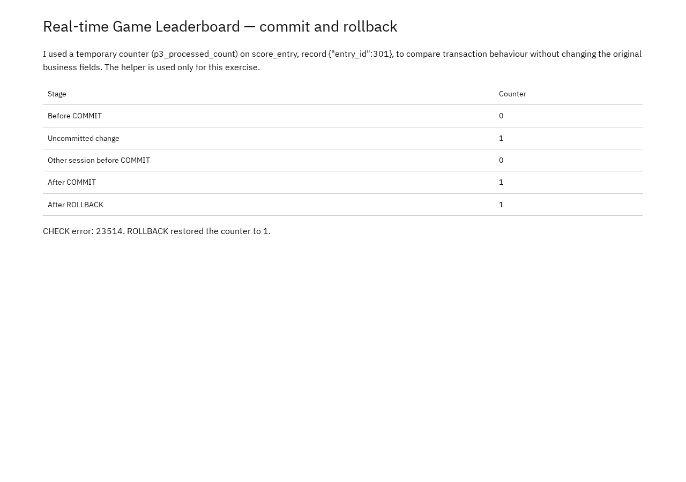
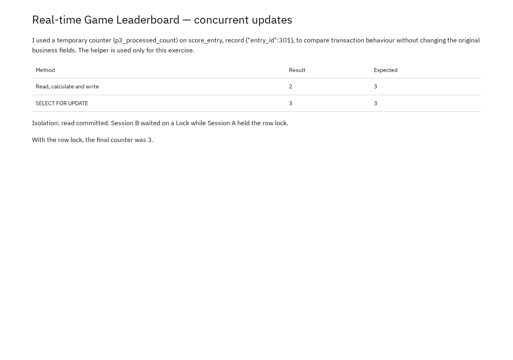

# Portfolio 3 — Transactions and Concurrency

## Purpose and case-study context

Leaderboard counter updates must not disappear when two sessions update the same score record at the same time. This portfolio demonstrates three things in PostgreSQL:

1. `COMMIT` makes a change durable and visible to other sessions.
2. `ROLLBACK` discards a failed transaction and restores the last committed value.
3. `SELECT FOR UPDATE` prevents the lost-update problem shown by a read-calculate-write sequence.

The exercise adds a temporary `p3_processed_count` counter to `score_entry` record `entry_id = 301`. The counter is **not part of the case design**; it exists only to make transaction behaviour visible. The original business fields and constraints are unchanged.

## Design and approach

### Test record

| Item | Value |
| --- | --- |
| Database | The Portfolio 1 `leaderboard` database |
| Table | `portfolio.score_entry` |
| Record | `entry_id = 301` |
| Helper column | `p3_processed_count integer NOT NULL DEFAULT 0` |
| Helper constraint | `p3_count_nonnegative CHECK (p3_processed_count >= 0)` |
| Isolation level | `READ COMMITTED` |
| Sessions | Two independent `psql` connections to the same database |

### Commit and rollback sequence

[Transactions.sql](Oyewale_Taiwo_301926988_P3_Transactions.sql) runs this sequence:

> **Session A:** `BEGIN` → `UPDATE ... +1` → `COMMIT` → read `1`
>
> **Session A:** `BEGIN` → `UPDATE ... +10` (uncommitted `11`) → attempt `UPDATE ... = -1` → CHECK failure `23514` → transaction aborted → `ROLLBACK` → read `1`

The second transaction deliberately fails and is rolled back, so the `+10` is never committed. A separate session reading the row while the first transaction is open sees the last committed value, not the uncommitted one.

### Two-session procedures

[SessionA.sql](Oyewale_Taiwo_301926988_P3_SessionA.sql) and [SessionB.sql](Oyewale_Taiwo_301926988_P3_SessionB.sql) are **checklists, not files to execute straight through**. Run the statements interactively in the numbered order; otherwise Session A can finish before Session B observes anything.

#### Part 1 — Lost update (no lock)

| Step | Session | Statement | What to observe |
| --- | --- | --- | --- |
| 1 | A | `BEGIN ISOLATION LEVEL READ COMMITTED;` then `SELECT entry_id, p3_processed_count FROM portfolio.score_entry WHERE entry_id IS NOT DISTINCT FROM 301;` | Reads `1`; transaction stays open |
| 2 | B | Same `BEGIN` and `SELECT` as step 1 | Also reads `1` before A writes |
| 3 | A | `UPDATE ... SET p3_processed_count = 2 ...; COMMIT;` | Writes the value calculated from its earlier read |
| 4 | B | `UPDATE ... SET p3_processed_count = 2 ...; COMMIT;` then `SELECT ...` | Writes its own stale value; final count is `2`, so one increment is lost |

Both sessions read `1` and both write `2`. The expected correct result after two increments is `3`; without locking it is `2`.

#### Part 2 — SELECT FOR UPDATE (locked)

| Step | Session | Statement | What to observe |
| --- | --- | --- | --- |
| 5 | A | `UPDATE portfolio.score_entry SET p3_processed_count = 1 WHERE entry_id IS NOT DISTINCT FROM 301;` **outside any transaction** | Resets the row to the equal starting value `1` |
| 6 | A | `BEGIN ISOLATION LEVEL READ COMMITTED;` then `SELECT ... WHERE entry_id IS NOT DISTINCT FROM 301 FOR UPDATE;` | Reads `1` and holds a row lock; transaction stays open |
| 7 | B | `BEGIN ISOLATION LEVEL READ COMMITTED;` then the same `SELECT ... FOR UPDATE;` | **Blocks and waits**; it does not return while A holds the lock |
| 8 | A | `UPDATE ... SET p3_processed_count = 2 ...; COMMIT;` | Commits `2` and releases the lock |
| 9 | B | The waiting `SELECT` now returns; then `UPDATE ... SET p3_processed_count = 3 ...; COMMIT;` then `SELECT ...` | The SELECT returns the committed value `2`; B writes `3`; final count is `3` |

At step 7, Session B's prompt should appear to hang. In a third `psql` session, the wait can be confirmed with:

```sql
SELECT pid, state, wait_event_type, wait_event
FROM pg_stat_activity
WHERE query LIKE '%FOR UPDATE%';
```

Expected: Session B shows `wait_event_type = Lock` (the recorded evidence reports `Lock`). It is released when Session A commits at step 8. Under `READ COMMITTED`, the blocked statement then sees the newly committed row and returns `2`, which is why B's increment produces `3`.

### Isolation assumptions

- Both sessions use `READ COMMITTED`, PostgreSQL's default isolation level.
- Each session keeps its transaction open across the steps shown; the reset at step 5 and any verification statements run in autocommit mode.
- No other session updates record 301 during the test.
- The row lock is held until the owning transaction commits or rolls back.
- `p3_count_nonnegative` is a real CHECK constraint, so the `-1` update fails with SQLSTATE `23514`.
- The test uses one row and no deadlock-prone lock ordering; it does not test `SERIALIZABLE`, `REPEATABLE READ`, or multi-row deadlocks.

## Files

| File | Contents |
| --- | --- |
| [Transactions.sql](Oyewale_Taiwo_301926988_P3_Transactions.sql) | Adds the helper counter, runs the commit and rollback sequence |
| [Session A.sql](Oyewale_Taiwo_301926988_P3_SessionA.sql) | Numbered statements for Session A (steps 1, 3, 5, 6, 8) |
| [Session B.sql](Oyewale_Taiwo_301926988_P3_SessionB.sql) | Numbered statements for Session B (steps 2, 4, 7, 9) |
| [Commit and rollback evidence](screenshots/Oyewale_Taiwo_301926988_P3_CommitRollback.png) | Captured stage values (Figure 1) |
| [Concurrency evidence](screenshots/Oyewale_Taiwo_301926988_P3_ConcurrencyResult.png) | Lost-update result versus `SELECT FOR UPDATE` (Figure 2) |

## Prerequisites

- PostgreSQL 17 server and `psql` 17 (recent PostgreSQL versions should also work).
- The Portfolio 1 schema and sample data loaded in a database; the test needs `score_entry` record 301.
- Two interactive `psql` connections to that database for the concurrency test, plus an optional third for the wait check.
- Permission to alter `portfolio.score_entry`.
- Run the commands from this `portfolio-3-transactions-concurrency` folder.
- Expected starting state: the `portfolio` schema has one score entry with `entry_id = 301` and no `p3_processed_count` column.

## How to run

Create and load the Portfolio 1 database, then add the helper column and run the commit/rollback sequence:

```bash
createdb -U postgres leaderboard
psql -U postgres -d leaderboard -v ON_ERROR_STOP=1 -f ../portfolio-1-database-design/Oyewale_Taiwo_301926988_P1_Schema.sql
psql -U postgres -d leaderboard -v ON_ERROR_STOP=1 -f ../portfolio-1-database-design/Oyewale_Taiwo_301926988_P1_SampleData.sql
psql -U postgres -d leaderboard -f Oyewale_Taiwo_301926988_P3_Transactions.sql
```

`psql` must continue after the deliberate CHECK error, so do not use `-v ON_ERROR_STOP=1` for the transactions file. The file contains `\set ON_ERROR_STOP off` around the failing statement and reports the error, then rolls back.

The commit/rollback evidence was captured by pausing after the first `UPDATE ... +1` and reading from a second session. To re-demonstrate the visibility rule after the transactions file finishes (counter = `1`), open two `psql` connections:

```bash
psql -U postgres -d leaderboard
```

In Session A, run:

```sql
BEGIN ISOLATION LEVEL READ COMMITTED;
UPDATE portfolio.score_entry
SET p3_processed_count = p3_processed_count + 1
WHERE entry_id IS NOT DISTINCT FROM 301;
```

In Session B, before Session A commits, run:

```sql
SELECT entry_id, p3_processed_count
FROM portfolio.score_entry
WHERE entry_id IS NOT DISTINCT FROM 301;
```

Expected: Session B sees `1`, while Session A sees its uncommitted `2`. Session B never sees `2` until Session A commits. Roll back Session A afterwards and reset the counter if needed:

```sql
ROLLBACK;
```

For the two-session comparison, open two terminals:

```bash
psql -U postgres -d leaderboard
```

Follow steps 1–9 in the tables above, copying statements from [SessionA.sql](Oyewale_Taiwo_301926988_P3_SessionA.sql) and [SessionB.sql](Oyewale_Taiwo_301926988_P3_SessionB.sql) as directed. Do not run either whole file at once.

### Reset the test data

After the concurrency test, the counter is `3`. Reset it to the starting value before repeating Part 1 or Part 2:

```sql
UPDATE portfolio.score_entry
SET p3_processed_count = 1
WHERE entry_id IS NOT DISTINCT FROM 301;
```

To remove the helper completely and rerun the commit/rollback file from scratch:

```sql
ALTER TABLE portfolio.score_entry DROP COLUMN p3_processed_count;
```

Then rerun `psql -U postgres -d leaderboard -f Oyewale_Taiwo_301926988_P3_Transactions.sql`.

## Results and evidence

### Commit and rollback

| Stage | Scope | Counter | Explanation |
| --- | --- | --- | --- |
| 1. Baseline | Committed value before the exercise | 0 | New helper column defaults to 0 |
| 2. Uncommitted `+1` | Session A, inside its first transaction | 1 | Visible only inside Session A |
| 3. Concurrent read | Session B, `READ COMMITTED` | 0 | Uncommitted change is hidden |
| 4. After `COMMIT` | Committed value | 1 | `+1` is durable and visible to both sessions |
| 5. Uncommitted `+10`, failed check | Session A, inside its second transaction | 11 | Never committed; the `-1` update fails with 23514 and aborts the transaction |
| 6. After `ROLLBACK` | Committed value | 1 | Restores the last committed value; the `+10` is discarded |

The failed transaction also rejects the following `SELECT 1` until it is rolled back. The final read returns `1`.



Figure 1. Captured commit/rollback evidence: uncommitted `1`, concurrent read `0`, committed `1`, and `1` after rollback.

### Two-session comparison

| Method | Result | Expected |
| --- | --- | --- |
| Read, calculate and write (no lock) | 2 | 3 |
| `SELECT FOR UPDATE` | 3 | 3 |

Both sessions first read `1`. Without locking, both wrote `2`, so one increment was lost. With `SELECT FOR UPDATE`, Session B waited for Session A's lock, read the updated value `2`, and committed `3`. The observed wait type was `Lock`.



Figure 2. Captured two-session comparison: lost update without locking and correct result with `SELECT FOR UPDATE`.

## Limitations and reflection

- The counter is an artificial helper, not a leaderboard business field.
- The test runs locally with two sessions on one machine; it does not model network delays, distributed transactions or high contention.
- Only one row and one lock order are exercised, so deadlock behaviour is not tested.
- The row lock prevents lost updates for this pattern, but the application still needs a correct transaction boundary (lock, read, calculate, write, commit). A single atomic `UPDATE ... SET counter = counter + 1` would avoid the read-modify-write race without an explicit `SELECT FOR UPDATE`.
- Reflection: the two-session exercise shows that reading the same value twice is not the problem by itself; the problem is letting both sessions write a value calculated from the same stale read. Locking the row before reading preserves both increments. I would choose `READ COMMITTED` plus an appropriate lock or atomic update for this workload, and reserve stronger isolation for transactions that need a stable multi-row snapshot.

## References

- [PostgreSQL 17 — transaction isolation](https://www.postgresql.org/docs/17/transaction-iso.html)
- [PostgreSQL 17 — explicit locking](https://www.postgresql.org/docs/17/explicit-locking.html)
- [PostgreSQL 17 — CHECK constraints](https://www.postgresql.org/docs/17/ddl-constraints.html#DDL-CONSTRAINTS-CHECK-CONSTRAINTS)
