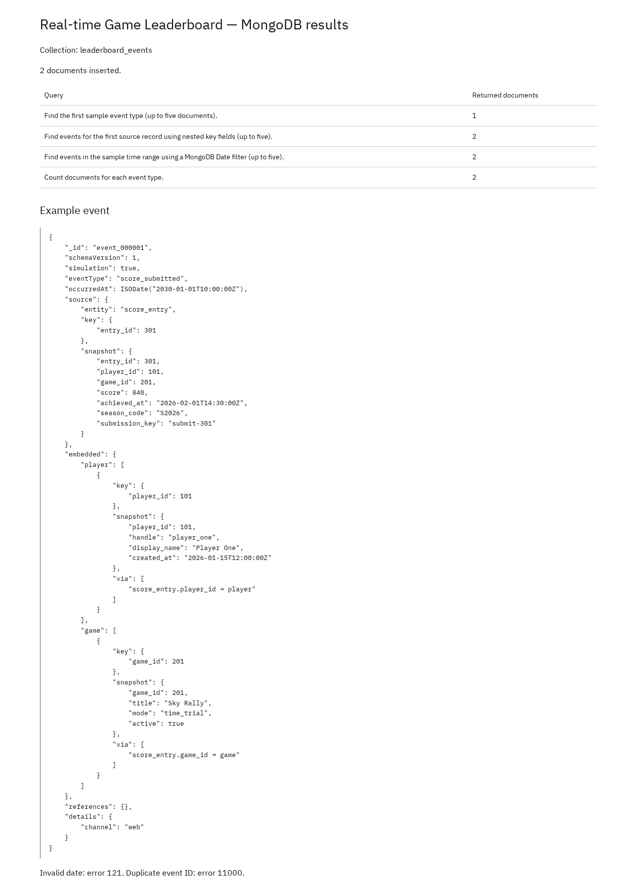

# Portfolio 4 — NoSQL and Advanced Data Models

## Purpose and case-study context

The Real-time Game Leaderboard already stores current players, games and score entries in PostgreSQL. It also needs an append-only history of what happened: score submissions and score corrections. This portfolio models those events as MongoDB documents in `leaderboard_events`, validates their shape, and runs four representative queries. The events are fictional examples derived from the Portfolio 1 sample data.

## Design and approach

### Document model

| Field | Meaning |
| --- | --- |
| `_id` | Unique string event ID |
| `schemaVersion` | Document-format version; currently `1` |
| `simulation` | Must be `true`; marks the records as fictional exercise data |
| `eventType` | `score_submitted` or `score_corrected` |
| `occurredAt` | Native BSON `Date`; the event time |
| `source` | Original entity, its key and a saved JSON snapshot |
| `embedded` | Linked player/game snapshots read with the event |
| `references` | Keys for linked sources kept outside the embedded snapshots |
| `details` | Event metadata whose fields vary by event type |

### Why this model suits the workload

- **One event, one readable document.** A viewer or operator can read the event and its player/game context without joining three collections.
- **Event-time context is preserved.** The embedded snapshots keep the player and game values as they were when the event was recorded, even if the PostgreSQL rows change later. That is useful for audit and correction history.
- **Separate event documents, not one growing history array.** Appending a document fits the write pattern and avoids an unbounded array inside a player or game document.
- **Variable `details`.** The validator checks the stable fields while `details` can differ by event type, such as a web channel versus a mobile correction with extra metadata.

The trade-off is controlled duplication: embedded snapshots duplicate PostgreSQL data, and later SQL updates do not propagate automatically. PostgreSQL remains authoritative for current players, games and scores; the MongoDB snapshots are historical evidence.

### Dates in the sample

The two timestamps serve different purposes and are **not meant to match**:

- `occurredAt` (`2030-01-01T10:00:00Z` and `10:01:00Z`) is the synthetic **event time** used for this exercise.
- `source.snapshot.achieved_at` (`2026-02-01T14:30:00Z`) is the copied **game achievement time** from the original PostgreSQL score entry.
- The embedded player's `created_at` (`2026-01-15T12:00:00Z`) is the copied **player registration time**.

So the 2030 value is the synthetic event occurrence time for the exercise; the 2026 values are the source business timestamps preserved inside the snapshot.

## Files

| File | Contents |
| --- | --- |
| [MongoDB script](Oyewale_Taiwo_301926988_P4_MongoDB.js) | Creates the validated collection, inserts two events, runs four queries, tests two rejected writes |
| [Documents and queries evidence](screenshots/Oyewale_Taiwo_301926988_P4_DocumentsAndQueries.png) | Captured query results, example document and validation errors (Figure 1) |

## Prerequisites

- MongoDB 7 server running locally (or a reachable MongoDB 7 deployment).
- `mongosh` 2.x on `PATH`.
- Permission to create a database and collection. The examples assume no authentication; for a secured server, supply the appropriate connection string and credentials.
- A **fresh exercise database**. The script selects `portfolio_nosql` itself and refuses to continue if `leaderboard_events` already exists.
- Run the command from this `portfolio-4-nosql` folder.

## How to run

Run the script against the local server:

```bash
mongosh "mongodb://127.0.0.1:27017" --file Oyewale_Taiwo_301926988_P4_MongoDB.js
```

The script calls `db.getSiblingDB('portfolio_nosql')`, so no separate `use portfolio_nosql` step is needed. If the database already contains the collection, reset it first:

```bash
mongosh "mongodb://127.0.0.1:27017/portfolio_nosql" --eval "db.dropDatabase()"
```

Expected output:

- `insertMany` acknowledges **2 inserted documents** with IDs `event_000001` and `event_000002`.
- Query 1 returns **1** document, query 2 returns **2**, query 3 returns **2**, and the aggregation returns **2 groups**.
- The invalid date insert prints `Invalid date error: 121`.
- The duplicate event ID insert prints `Duplicate ID error: 11000`.
- The final document count prints `Document count: 2`.

## Results and evidence

### Query results

| Query | Returned result |
| --- | --- |
| Find the first sample event type (up to five documents). | 1 document (`score_submitted`) |
| Find events for the first source record using nested key fields (up to five). | 2 documents for `source.key.entry_id = 301` |
| Find events in the sample time range using a MongoDB Date filter (up to five). | 2 documents between 10:00 and 11:00 on 2030-01-01 |
| Count documents for each event type. | 2 groups: `score_corrected` = 1, `score_submitted` = 1 |

### Example document

```javascript
{
    "_id": "event_000001",
    "schemaVersion": 1,
    "simulation": true,
    "eventType": "score_submitted",
    "occurredAt": ISODate("2030-01-01T10:00:00Z"),
    "source": {
        "entity": "score_entry",
        "key": { "entry_id": 301 },
        "snapshot": {
            "entry_id": 301,
            "player_id": 101,
            "game_id": 201,
            "score": 840,
            "achieved_at": "2026-02-01T14:30:00Z",
            "season_code": "S2026",
            "submission_key": "submit-301"
        }
    },
    "embedded": {
        "player": [
            {
                "key": { "player_id": 101 },
                "snapshot": {
                    "player_id": 101,
                    "handle": "player_one",
                    "display_name": "Player One",
                    "created_at": "2026-01-15T12:00:00Z"
                },
                "via": ["score_entry.player_id → player"]
            }
        ],
        "game": [
            {
                "key": { "game_id": 201 },
                "snapshot": {
                    "game_id": 201,
                    "title": "Sky Rally",
                    "mode": "time_trial",
                    "active": true
                },
                "via": ["score_entry.game_id → game"]
            }
        ]
    },
    "references": {},
    "details": { "channel": "web" }
}
```

### Query 1 — first event type

```javascript
db.getCollection("leaderboard_events").find({"eventType":"score_submitted"}).sort({_id:1}).limit(5).toArray();
```

Selected fields from the returned document:

```json
[
  {
    "_id": "event_000001",
    "eventType": "score_submitted",
    "occurredAt": { "$date": "2030-01-01T10:00:00Z" },
    "source": { "entry_id": 301 }
  }
]
```

### Query 2 — events for the first source record

```javascript
db.getCollection("leaderboard_events").find({"source.key.entry_id":301}).sort({_id:1}).limit(5).toArray();
```

Selected fields from the returned documents:

```json
[
  {
    "_id": "event_000001",
    "eventType": "score_submitted",
    "occurredAt": { "$date": "2030-01-01T10:00:00Z" },
    "source": { "entry_id": 301 }
  },
  {
    "_id": "event_000002",
    "eventType": "score_corrected",
    "occurredAt": { "$date": "2030-01-01T10:01:00Z" },
    "source": { "entry_id": 301 }
  }
]
```

### Query 3 — events in the sample time range

```javascript
db.getCollection("leaderboard_events").find({"occurredAt":{"$gte":ISODate("2030-01-01T10:00:00Z"), "$lt":ISODate("2030-01-01T11:00:00Z")}}).sort({_id:1}).limit(5).toArray();
```

Returns the same two documents as query 2, both inside the time range.

### Query 4 — count by event type

```javascript
db.getCollection("leaderboard_events").aggregate([{"$group":{"_id":"$eventType", "documentCount":{"$sum":1}}}, {"$sort":{"_id":1}}]).toArray();
```

| _id | documentCount |
| --- | --- |
| `score_corrected` | 1 |
| `score_submitted` | 1 |

### Validation

| Test | Result |
| --- | --- |
| Insert a document with `occurredAt: "not-a-date"` | Rejected by the JSON Schema validator, code **121** |
| Insert a second document with `_id: "event_000001"` | Rejected by the unique `_id` index, code **11000** |
| Collection after both rejections | **2** valid documents remain |

The script also creates a compound `{eventType: 1, occurredAt: -1}` index for those access fields. This exercise does not measure its speed, because two documents are not a meaningful performance test.



Figure 1. Captured MongoDB evidence: 2 inserted documents, the four query results, an example event and the two validation errors.

## Limitations and reflection

- The collection holds only two fictional documents, so it demonstrates the model and validator rather than scale.
- Embedded snapshots duplicate relational data and can become stale when PostgreSQL changes; the design intentionally treats them as event-time history.
- The validator enforces the stable fields and the `occurredAt` type, but it does not encode every business rule (for example, the meaning of `details` or the correctness of the source snapshot).
- MongoDB is a single local server here; replication, sharding and failover are discussed only in Portfolio 5.
- There is no cross-database transaction between PostgreSQL and MongoDB. Keeping the two stores consistent would need an outbox or a retrying consumer in a real implementation.
- The compound index is created but not benchmarked; its usefulness should be checked against real query patterns and document volume.
- Reflection: the document model is a good fit for an event log because each event is read as one unit and its `details` vary. It is a poor replacement for the relational source of truth because the same player and game facts would be duplicated across events and would need a deliberate update strategy.

## References

- [MongoDB — data modelling](https://www.mongodb.com/docs/manual/data-modeling/)
- [MongoDB — schema validation](https://www.mongodb.com/docs/manual/core/schema-validation/)
- [MongoDB — `$jsonSchema`](https://www.mongodb.com/docs/manual/reference/operator/query/jsonSchema/)
