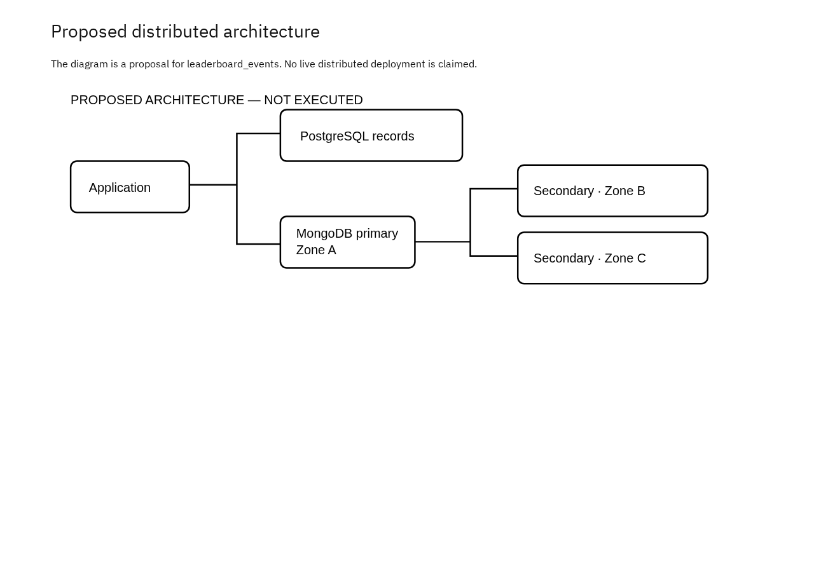

# Portfolio 5 — Distributed and Cloud Database Exercise

## Status: proposed design only

> **This portfolio is a reasoned design/discussion, not a deployed or tested cluster.** No MongoDB replica set, shard cluster, cloud service, failover or restore was provisioned for this assessment. Anything described below is a proposal unless it is explicitly marked as implemented.

## Purpose and case-study context

The Real-time Game Leaderboard keeps current relational records in PostgreSQL and event documents in MongoDB. A production deployment would need the event log to survive a server or availability-zone failure. This portfolio proposes a MongoDB replica-set topology for `leaderboard_events`, analyses consistency and failure behaviour, discusses sharding trade-offs, and states what would be required for cloud deployment and recovery.

Figure 1. Proposed three-member MongoDB replica set across three availability zones, with a separate PostgreSQL deployment. The diagram is a proposal; no live distributed deployment is claimed.

## Design and approach

### Proposed topology

| Component | Proposal |
| --- | --- |
| Region | One cloud region |
| Failure domains | Three availability zones, A, B and C |
| MongoDB members | Three voting replica-set members: one primary, two secondaries; no arbiters |
| Initial placement | Primary in Zone A; one secondary each in Zones B and C |
| Application | Connects to the replica set through a MongoDB connection string; retries use an idempotency key |
| PostgreSQL | Stays a separate database deployment with its own managed high-availability plan |
| Replication | MongoDB asynchronous oplog replication from primary to secondaries |
| Write concern | `majority` with a finite timeout for durable event writes |
| Read preference | Primary for requests that need the latest committed event; secondaries only for lag-tolerant reads |

The MongoDB replica set does **not** replicate PostgreSQL. The two stores need separate availability, backup and recovery plans, and no atomic transaction spans both.

### Failure assumptions

With three voting members, a majority is **two**. The proposal assumes all three members can communicate and vote, no member is an arbiter, and elections use default priorities unless an operator changes them.

| Failure scenario | Voting members available | Expected behaviour |
| --- | --- | --- |
| No failure | 3 of 3 | The primary accepts writes; secondaries copy the oplog |
| One secondary or one non-primary zone fails | 2 of 3 | A majority remains. Writes continue; if the primary was the failed member, the surviving majority elects a new primary |
| Primary's zone fails | 2 of 3 | The old primary stops accepting writes; the remaining members elect a replacement. Writes pause during the election |
| Two zones fail | 1 of 3 | No majority, so no election and no primary; writes are unavailable until a majority returns |
| Network partition isolates a minority | Minority has fewer than 2 votes | The minority cannot elect a primary; the side with the majority continues |
| Loss of the whole region | 0 of 3 | The replica set cannot recover by itself; recovery requires a cross-region copy and tested backups |

### Consistency behaviour

- Replication is asynchronous, so a secondary can lag behind the primary. A secondary read may return an older event.
- With `w: majority`, an acknowledged write has reached a majority of voting members and survives the failure of a minority. With `w: 1`, an acknowledged write can be lost if the primary fails before replication.
- A finite `wtimeout` prevents an application from waiting indefinitely, but a timeout does not prove the write failed. The application must retry with the same idempotency key and handle a possible duplicate.
- `readConcern: "majority"` returns data acknowledged by a majority; `"local"` can return data that is not yet majority-committed. The choice depends on whether the request can tolerate rollback of an uncommitted write.
- For the leaderboard, a short delay in the historical event feed is acceptable; a score submission that the user believes was accepted should be written with majority acknowledgement.
- PostgreSQL constraints remain authoritative for current relational data, including unique player handles and non-negative scores. MongoDB snapshots are historical copies, not a second source of truth.

### Sharding trade-off

Sharding partitions documents across shards; replication copies each shard for availability. The two mechanisms solve different problems, and a replica set is not a shard cluster.

The two-document sample does not need sharding. If `leaderboard_events` grows large, a high-cardinality source-record identifier (for example, a hashed `source.key.entry_id`) is a candidate shard key, but it must be evaluated against the actual query pattern:

- a time-only, ever-increasing key can concentrate new writes on the last chunk;
- a hashed key spreads writes but can make time-range queries contact several shards;
- the shard key should support the most common equality/range access, and its distribution and query plans must be validated before deployment.

No shard key was tested.

### Cloud deployment and recovery requirements

A real deployment would additionally need:

- private networking and restricted network access;
- authentication, least-privilege database roles and TLS;
- monitoring, alerting and audit logging;
- automated, encrypted backups with tested point-in-time restore;
- a cross-region strategy for regional disaster recovery;
- a documented failover and restore runbook.

Replication is not a backup: it also copies accidental deletions and corruption. Availability zones protect against a zone failure, not the loss of the whole region. Backup restores and failover must be tested, not just configured.

## What was reasoned about versus implemented

| Activity | Status |
| --- | --- |
| Document model and a single-node MongoDB collection | **Implemented and verified** in [Portfolio 4](../portfolio-4-nosql/README.md) |
| Validator, four queries, two rejected writes | **Implemented and verified** in Portfolio 4 |
| Three-member replica-set topology | **Proposed only** |
| Primary election, quorum loss, secondary lag, rollback of uncommitted writes | **Reasoned about from MongoDB documentation**, not observed |
| Majority write/read concern settings | **Proposed**, not benchmarked |
| Shard key and distribution | **Discussed only**, not tested |
| Cloud networking, security, monitoring | **Proposed**, not provisioned |
| Backup and point-in-time restore | **Proposed**, not performed |
| Failover, partition and disaster-recovery tests | **Not performed** |

## Results and evidence

The only artifact is the proposed architecture in Figure 1. There is **no operational evidence**: no cluster was created, no election or failover was observed, no shard was added, and no backup was restored. The failure table and consistency discussion are design reasoning from the cited MongoDB documentation, not measurements. This is the permitted discussion option for the portfolio.

## Files

| File | Contents |
| --- | --- |
| [Proposed architecture image](screenshots/Oyewale_Taiwo_301926988_P5_ProposedDesign.png) | Figure 1: proposed three-member replica set across three zones |

## Prerequisites and how to run

Not applicable. This portfolio has no executable script and does not require PostgreSQL or MongoDB. To review it, read this document alongside [Portfolio 4](../portfolio-4-nosql/README.md), which is the only implemented MongoDB evidence in the repository.

## Limitations and reflection

- The design is not deployed, so election timing, replication lag, write latency and recovery time are unknown.
- The three-zone/one-region assumption avoids regional failure; it deliberately does not claim disaster recovery.
- The proposal does not include a cost analysis, capacity estimate or load test.
- PostgreSQL high availability is acknowledged but not designed in detail.
- Cross-store consistency between PostgreSQL and MongoDB is not implemented; an outbox and retrying consumer would be required.
- Reflection: replication improves availability but changes the failure model rather than removing failures. A three-member set tolerates one zone loss, not two, and majority acknowledgement trades write latency for durability. The important operational lesson is that a replica set is not a backup and that failover and restore need to be tested before they are relied on.

## References

- [MongoDB — replication](https://www.mongodb.com/docs/manual/replication/)
- [MongoDB — replica-set elections](https://www.mongodb.com/docs/manual/core/replica-set-elections/)
- [MongoDB — write concern](https://www.mongodb.com/docs/manual/reference/write-concern/)
- [MongoDB — read concern](https://www.mongodb.com/docs/manual/reference/read-concern/)
- [MongoDB — sharding](https://www.mongodb.com/docs/manual/sharding/)
- [MongoDB — backup methods](https://www.mongodb.com/docs/manual/core/backups/)
